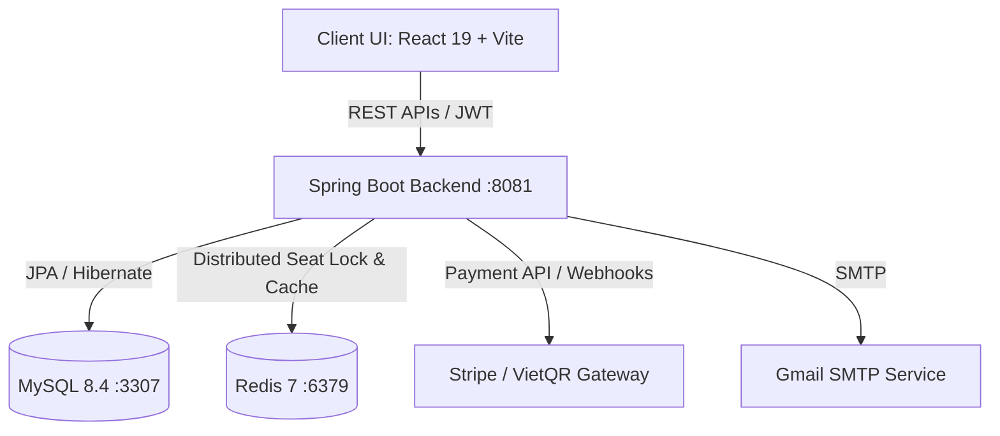

# 🎬 Movie Ticket Booking System

A full-stack, enterprise-grade movie ticket booking platform built with **Spring Boot 3 (Java 21)**, **React 19 (Vite)**, **MySQL 8.4**, and **Redis**. Designed with distributed seat locking, secure JWT authentication, rate limiting, and Stripe/VietQR payment integration.

---

## 📑 Table of Contents
- [Key Features](#-key-features)
- [System Architecture](#-system-architecture)
- [Tech Stack](#-tech-stack)
- [Project Structure](#-project-structure)
- [Prerequisites](#-prerequisites)
- [Environment Variables](#-environment-variables)
- [Getting Started](#-getting-started)
  - [Method 1: Run with Docker Compose (Recommended)](#method-1-run-with-docker-compose-recommended)
  - [Method 2: Run Manually (Local Development)](#method-2-run-manually-local-development)
- [Default Accounts & Initial Data](#-default-accounts--initial-data)
- [API Documentation](#-api-documentation)
- [License](#-license)

---

## 🌟 Key Features

### 👤 Customer (User)
- **Authentication & Security:** Register, login, forgot/reset password with OTP verification via email, refresh token rotation, and JWT authentication.
- **Movie Browsing:** Browse movies by status (*Now Showing*, *Coming Soon*), search, filter by genres, and view detailed information.
- **Real-Time Seat Booking:** Interactive visual seat selection with real-time seat locking mechanism powered by **Redis Lock (TTL 300s)** to prevent concurrent double-booking.
- **Payment Integration:** Multiple payment methods including **Stripe** and **VietQR** with transaction verification.
- **Ticket & History Management:** View booking history, booking details, and personal profile management.

### 🛡️ Administrator (Admin)
- **Movie Management:** Full CRUD operations for movies, movie schedules, banners, posters, and statuses.
- **Cinema & Room Management:** Manage cinemas, screening rooms, seat configurations (VIP, Regular, Couple).
- **Showtime Management:** Schedule showtimes with dynamic pricing and room assignments.
- **Booking & Transaction Management:** Monitor all booked tickets and payment statuses.

---

## 🏛️ System Architecture



---

## 💻 Tech Stack

| Layer | Technologies |
| :--- | :--- |
| **Frontend** | React 19, Vite, React Router v7, Axios, Tailwind CSS / Modern CSS |
| **Backend** | Spring Boot 3.4.x / 4.x, Java 21, Spring Security, Spring Data JPA, Hibernate |
| **Caching & Locking** | Redis 7 (Seat lock TTL, Cacheable endpoints) |
| **Database** | MySQL 8.4 (InnoDB) |
| **Authentication** | JWT (JSON Web Tokens), Refresh Token with HttpOnly Cookie support, BCrypt |
| **DevOps & Containers** | Docker, Docker Compose, Nginx |

---

## 📂 Project Structure

```text
MovieTicketBooking/
├── backend/                  # Spring Boot application
│   ├── src/main/java/        # Controllers, Services, Models, Repositories, Configs
│   ├── src/main/resources/   # application.properties
│   ├── Dockerfile            # Multi-stage Docker build for backend
│   └── pom.xml               # Maven dependencies
├── frontend/                 # React SPA application
│   ├── src/                  # Components, Pages, Services, Contexts
│   ├── Dockerfile            # Multi-stage Docker build with Nginx
│   ├── package.json          # Node dependencies
│   └── vite.config.js        # Vite configuration
├── database/                 # Database initialization scripts
│   └── init.sql              # Schema definitions and sample data
├── docker-compose.yml        # Orchestration for MySQL, Redis, Backend, and Frontend
└── README.md
```

---

## ⚙️ Prerequisites

Make sure you have installed:
- [Docker](https://docs.docker.com/get-docker/) & [Docker Compose](https://docs.docker.com/compose/) *(Recommended)*
- Or for local manual setup:
  - **JDK 21**
  - **Node.js** (v18+) & **npm**
  - **MySQL Server 8.4+**
  - **Redis 7+**

---

## 🔐 Environment Variables

Before starting the project, configure your environment variables:

### 1. Root `.env` (Used by Docker Compose)
Create a `.env` file in the root folder:

```env
# Database Credentials
DB_NAME=movie_ticket_booking
DB_ROOT_PASSWORD=your_mysql_root_password
```

### 2. Backend Configuration (`backend/.env` or system environment)
Create `backend/.env` or specify them in environment:

```env
SPRING_DATASOURCE_URL=jdbc:mysql://mysql:3306/movie_ticket_booking?createDatabaseIfNotExist=true&useUnicode=true&characterEncoding=UTF-8
SPRING_DATASOURCE_USERNAME=root
SPRING_DATASOURCE_PASSWORD=your_mysql_root_password
REDIS_HOST=redis

# Security
JWT_SECRET=your_jwt_secret_key_at_least_256_bits_long
JWT_EXPIRATION=86400000

# Mail Configuration (Optional for Forgot Password OTP)
MAIL_USERNAME=your_email@gmail.com
MAIL_PASSWORD=your_google_app_password

# Stripe (Optional)
STRIPE_SECRET_KEY=your_stripe_secret_key
STRIPE_PUBLISHABLE_KEY=your_stripe_publishable_key
```

---

## 🚀 Getting Started

### Method 1: Run with Docker Compose (Recommended)

1. **Clone the repository:**
   ```bash
   git clone https://github.com/your-username/MovieTicketBooking.git
   cd MovieTicketBooking
   ```

2. **Configure environment variables:**
   Ensure your `.env` file is created as described above.

3. **Build and launch all services:**
   ```bash
   docker compose up -d --build
   ```

4. **Verify container status:**
   ```bash
   docker compose ps
   ```

5. **Access the application:**
   - **Frontend:** [http://localhost:3000](http://localhost:3000)
   - **Backend API:** [http://localhost:8081/api](http://localhost:8081/api)
   - **MySQL Database:** `localhost:3307`
   - **Redis:** `localhost:6379`

> **Note on Database Initialization:**  
> On first startup, Docker automatically executes `database/init.sql` to populate sample cinemas, movies, rooms, seats, and showtimes.

---

### Method 2: Run Manually (Local Development)

#### 1. Start MySQL & Redis
Ensure MySQL is running on port `3306` (or `3307`) with database `movie_ticket_booking` and Redis on port `6379`.  
Import `database/init.sql` into MySQL if starting clean.

#### 2. Run Backend
```bash
cd backend
./mvnw clean spring-boot:run
# On Windows:
# .\mvnw.cmd clean spring-boot:run
```
Backend will be available at `http://localhost:8081`.

#### 3. Run Frontend
```bash
cd frontend
npm install
npm run dev
```
Frontend will be available at `http://localhost:5173`.

---

## 🔑 Default Accounts & Initial Data

The system automatically initializes an administrator account on first boot (via `DataInitializer` / `CommandLineRunner`):

| Role | Email | Password | Access |
| :--- | :--- | :--- | :--- |
| **Admin** | `yudcoder@gmail.com` | `yudcoder` *(or configured admin pass)* | Full Admin Dashboard (`/admin`) |
| **Customer** | *(Self-register via `/register`)* | *(Chosen password)* | Customer Booking Portal |

---

## 📖 API Documentation

Once the backend is running, you can explore the OpenAPI / Swagger documentation:
- **Swagger UI:** [http://localhost:8081/swagger-ui/index.html](http://localhost:8081/swagger-ui/index.html)
- **OpenAPI JSON:** [http://localhost:8081/v3/api-docs](http://localhost:8081/v3/api-docs)

### Core Endpoints Summary:
- `POST /api/auth/register` - User registration
- `POST /api/auth/login` - User/Admin authentication (Returns JWT)
- `POST /api/auth/refresh` - Refresh access token
- `GET  /api/movies/now-showing` - Get currently showing movies
- `GET  /api/movies/coming-soon` - Get upcoming movies
- `POST /api/movies/add` - Add new movie (Admin)
- `PUT  /api/movies/edit` - Update movie info (Admin)
- `POST /api/tickets/book` - Reserve/book ticket with seat lock
- `GET  /api/tickets/history` - User ticket history

---

## 📄 License

This project is licensed under the [MIT License](LICENSE).

